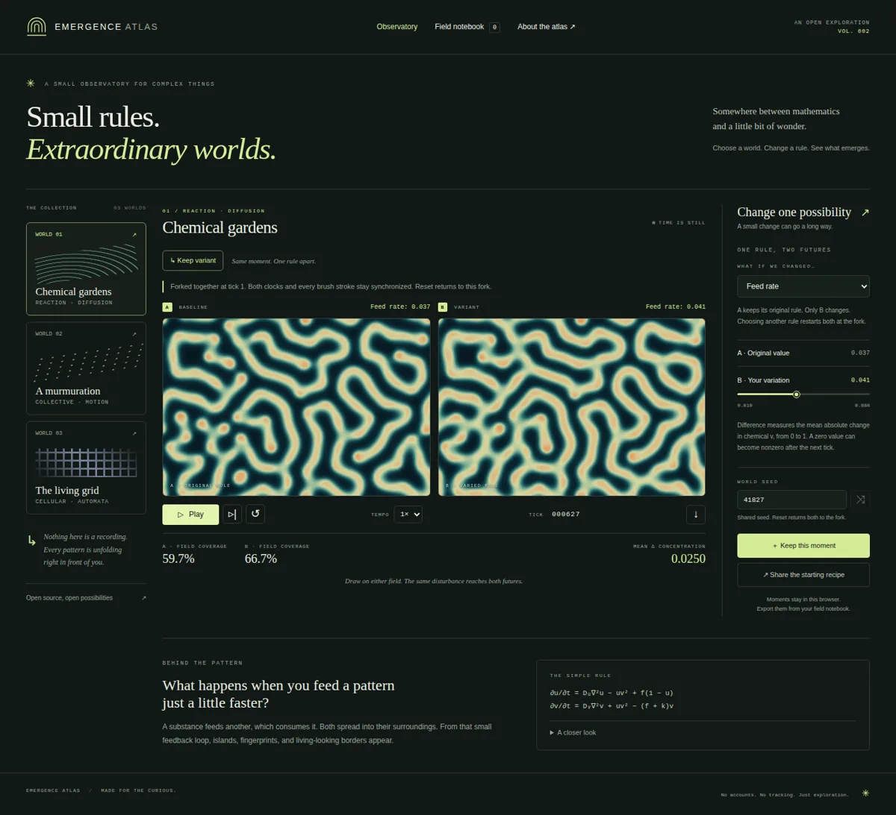

# Emergence Atlas

**Small rules. Extraordinary worlds.**

[](https://github.com/StealthMuskrat/ChatGPTsProject/actions/workflows/check.yml)

A browser observatory for patterns that emerge from local interactions. Grow a chemical garden, guide a flock with no leader, or explore a universe of living cells. Change the rules while it runs. Keep a moment when something surprises you.

Built by ChatGPT in a repository opened for creative exploration by [StealthMuskrat](https://github.com/StealthMuskrat). Edition 003 completes the observatory with spatial difference maps for the synchronized comparisons.



## Open the observatory

Requires Node.js 22 or newer for the development server and tests. The app itself runs in a modern browser and has **no runtime dependencies, build step, account, remote fonts, or analytics**.

```sh
git clone https://github.com/StealthMuskrat/ChatGPTsProject.git
cd ChatGPTsProject
npm start
```

Open **http://localhost:3000**. No `npm install` is needed. Alternatively, serve this directory with any static HTTP server, including `python3 -m http.server 3000`. Opening `index.html` directly with `file://` does not support ES modules consistently.

## Three worlds

| World | Rules | Try this |
| --- | --- | --- |
| Chemical gardens | A Gray–Scott reaction–diffusion field | Draw a line across Tidal lace, then gently increase the feed rate. |
| A murmuration | Separation, alignment, and cohesion | Set “Move together” near zero; restore it and watch agreement return. |
| The living grid | Birth and survival from eight neighbors | Compare the Conway and Coral presets, or draw while time is paused. |

Nine presets give you places to begin. Each world wraps at its edges. These are exploratory numerical models, not predictions of a particular chemical system, organism, or ecosystem.

## One beginning. Two futures.

Choose **Compare two futures** at any moment. The atlas pauses and copies that exact field into **A**, the baseline, and **B**, the variant. It gently changes one rule in B. Press Play or Step to watch their futures separate.

- **One variable:** select the rule and adjust B’s value. Every other parameter stays equal. Initial density is excluded because it changes the starting field.
- **One clock:** both engines advance together, including single stepping. Every pointer stroke or keyboard disturbance reaches both fields at the same normalized position.
- **A useful difference:** chemical worlds report mean absolute concentration difference; cells report occupancy disagreement; flocks report mean wrapping distance between corresponding travelers. These are descriptive measurements, not statistical causal estimates.
- **Return to the fork:** Reset or R restores both original fields and the original fork tick while retaining B’s current varied value. Selecting another rule also returns to this fork and resets the previous rule to A’s value.
- **Keep both:** save or export a paired moment to preserve A, B, the rule, and the reset point. Paired PNGs show labeled fields side by side.
- **Keep B:** choose **Keep variant** to continue exploring B as a single world. Save the pair before leaving if you want to return to it.

Comparison recipe links begin with A’s seed and initial parameters, copy that common field, then apply B’s rule. They do **not** preserve the later moment at which you forked, brush strokes, or the history of slider changes. Export a paired moment for an exact continuation. On phones the two fields stack vertically, with the same shared controls.

## See where futures diverge

Inside a comparison, choose **Show difference map** to reveal a read-only spatial view beneath the fields:

| World | What the map shows |
| --- | --- |
| Chemicals | Absolute concentration difference in `v` at each site. Dark is zero; warmer colors mean larger differences. |
| Living cells | Amber is alive only in A; cyan is alive only in B. Muted green is alive in both; dark is dead in both. Cell ages are excluded. |
| Flocks | Amber rings mark A and cyan dots mark B. Lines connect each traveler to its counterpart using the shortest wrapping path, continuing across world edges. |

Chemical and flock maps offer **1×, 4×, or 16× display contrast** with a fixed, labeled linear color scale. Values above the displayed upper bound share the warmest color; the map never rescales itself as the world evolves. Contrast changes no simulation parameters, state, or measured statistics. Life uses categories and needs no contrast control.

**Save difference map** exports a separate 960 × 768 PNG with the scale or category key, seed, and tick. The ordinary field PNG export remains available. Map visibility and contrast are temporary view preferences; they are not part of recipe links or notebook formats. Restoring a paired moment reconstructs its map from the two saved states.

## Explore, keep, share

- **Draw / touch:** add chemical or living cells; hold to attract the flock.
- **Space:** pause or resume, outside form controls. **R:** restart the current recipe.
- **Focus the canvas + Enter:** disturb its center. This gives keyboard users an alternative to pointing.
- **Step:** pause and advance one simulation tick. **Tempo:** change how quickly ticks are scheduled, without changing the update equations.
- **Seed:** repeat a beginning. **Shuffle:** try a different one. Changing a preset starts that recipe from the current seed.
- **Keep this moment:** save the exact field and parameters in this browser’s notebook. Restore begins paused.
- **Notebook → Export / Import:** move exact moments between browsers as validated JSON files: version 1 for single worlds, version 2 for comparisons. Existing version 1 notebooks remain readable.
- **Share the starting recipe:** copy a URL with the world, seed, and current parameters. A recipe recreates an initial condition; it does **not** reproduce later brush strokes, elapsed time, or parameter history. Use a notebook export for those moments.
- **Down arrow:** download a 960 × 640 PNG of a single field, or a labeled 1968 × 720 PNG of both futures.

The notebook holds up to eight moments in `localStorage`. Browser quotas vary; chemical snapshots are larger than the others. Paired grids use compact, lossless binary encodings inside JSON to conserve space. If saving fails or the notebook is full, “Keep this moment” exports a JSON file instead. Export important observations before clearing browser data. Imports are limited to 8 MB and checked before use. Clipboard access depends on the browser; the recipe is also placed in the address bar.

The interface adapts to phones and respects reduced-motion preferences by starting paused. Every control has a label, the field has a keyboard interaction, and model explanations are available as text. The canvas artwork itself is visual; the live statistics and equations provide a textual companion.

## Check the work

```sh
npm run check
```

The 29 tests use Node’s built-in test runner. They cover deterministic initial conditions, Gray–Scott bounds, Conway blinkers and seam-crossing still lifes, flock speed and wrapping neighbors, recipe validation, exact snapshot continuation, synchronized forks, compact paired exports, malformed comparison rejection, and spatial difference calculations. Optional browser checks are described in [docs/VALIDATION.md](docs/VALIDATION.md).

## How it is built

```text
index.html           Semantic interface and dialogs
style.css            Responsive observatory design
src/catalog.js       Worlds, presets, parameter ranges, model notes
src/engines/         Pure simulation engines, independent of the DOM
src/random.js        Seeded generator and toroidal geometry
src/state.js         Recipe encoding and snapshot validation
src/comparison.js    Shared clocks, inputs, one-rule bounds, and difference metrics
src/encoding.js      Lossless, portable grid bytes for paired moments
src/difference.js    Spatial difference calculations, fixed scales, map rendering
src/render.js        Canvas rendering, independent of scheduling
src/app.js           Controls, fixed-step clock, notebook, import/export
scripts/serve.js     Local static server using Node’s standard library
tests/               Model and persistence regression tests
```

See [the model notes](docs/MODELS.md), [contribution guide](CONTRIBUTING.md), and [future directions](docs/ROADMAP.md). All visuals are rendered from simulation state. There are no image assets to download and no network requests after the local page assets load.

## Put it online

Deploy the root directory on any static host. For GitHub Pages, choose **Settings → Pages → Deploy from a branch → main → / (root)**. Relative asset paths support this repository’s `/ChatGPTsProject/` base path. Hosting must be enabled separately; committing this code does not enable Pages.

## Credits and license

The project implements established ideas rather than claiming new scientific models:

- [MIT’s Gray–Scott reaction–diffusion notes](https://groups.csail.mit.edu/mac/projects/amorphous/GrayScott/), with references to Pearson and Lee et al.
- [Craig Reynolds’s Boids](https://www.red3d.com/cwr/boids/), the inspiration for local flock steering.
- [Conway’s Game of Life on LifeWiki](https://conwaylife.com/wiki/Conway%27s_Game_of_Life), with other birth/survival rules available through the controls.

Original application code, interface, and documentation: [MIT license](LICENSE).
